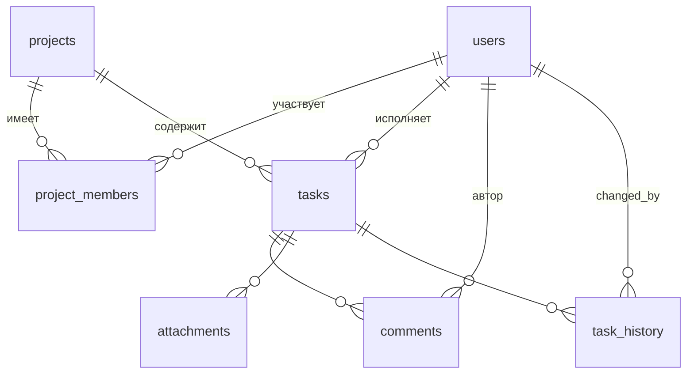

# TaskFlow 🌸

Практическое задание № 10 — мобильное приложение для управления проектами и задачами на **Flutter** с локальной базой **SQLite через Drift**. Работает полностью офлайн: все данные хранятся в файле `taskflow.sqlite` и сохраняются между запусками.

Интерфейс в нежной пастельной палитре: лаванда (основной цвет), мята, персик, пудровая роза, небесно-голубой и сливочный.

---

## Быстрый старт

```bash
# 1. Создать платформенные папки (android/ios), lib и test не будут затронуты
flutter create . --project-name taskflow --platforms android,ios

# 2. Зависимости
flutter pub get

# 3. Сгенерировать код Drift (появится lib/data/database/app_database.g.dart)
dart run build_runner build

# 4. Запуск
flutter run

# 5. Тесты (35 автотестов)
flutter test
```

> **Тесты на компьютере** используют in-memory SQLite (`NativeDatabase.memory()`), поэтому нужна системная библиотека SQLite:
> macOS — уже есть; Linux — `sudo apt install libsqlite3-dev`; Windows — положить `sqlite3.dll` рядом с `flutter.exe` или в `PATH`.

Первый запуск: вкладка **«Люди»** → добавить пользователей → **«Проекты»** → создать проект (создатель становится Owner) → добавить участников → создавать задачи. Переключить «текущего пользователя» (от чьего имени пишется история и комментарии) можно кнопкой с аватаром в правом верхнем углу.

---

## Архитектура

```
lib/
├── main.dart, app.dart          — точка входа, тема, локализация (ru)
├── data/
│   ├── database/                — DATABASE: таблицы Drift, AppDatabase, миграции, индексы
│   ├── repositories/            — REPOSITORY: все запросы к SQLite
│   ├── services/file_storage    — копирование вложений в папку приложения
│   └── validators.dart          — проверка данных перед сохранением
├── models/                      — MODEL: enum-ы, DTO (TaskWithDetails, TaskPage, DashboardStats…), исключения
├── state/providers.dart         — STATE MANAGEMENT: Riverpod (StreamProvider поверх Drift watch())
└── presentation/                — PRESENTATION: тема, виджеты, экраны
```

* В виджетах **нет SQL** — они вызывают только методы репозиториев через провайдеры.
* Ошибки бизнес-логики — типизированные исключения (`ValidationException`, `NotFoundException`, `BusinessRuleException`), UI показывает их понятным сообщением.

---

## База данных



| Таблица | Назначение | Ключевые ограничения |
|---|---|---|
| `users` | пользователи | `email UNIQUE` |
| `projects` | проекты (статус active/completed/archived, `end_date` необязательна) | — |
| `project_members` | Many-to-Many users ↔ projects + роль Owner/Admin/Member | `UNIQUE(project_id, user_id)`, `ON DELETE CASCADE` |
| `tasks` | задачи (priority, status, deadline, created/updated, **deleted_at** для корзины) | FK на проект (`CASCADE`) и исполнителя (`SET NULL`) |
| `comments` | комментарии | FK на задачу и автора (`CASCADE`) |
| `attachments` | вложения — **только путь к файлу** | FK на задачу (`CASCADE`) |
| `task_history` | история: тип события, старый/новый статус, старый/новый исполнитель, кто и когда, флаг `is_undone` | FK на задачу (`CASCADE`) |

Внешние ключи включаются `PRAGMA foreign_keys = ON` при каждом открытии БД.
Индексы (`lib/data/database/indexes.dart`): по проекту, исполнителю+статусу+дедлайну, статусу+приоритету, приоритету, дедлайну, дате создания, `deleted_at`, а также по `task_id` в комментариях, вложениях и истории.

---

## Где что реализовано

| Требование | Реализация |
|---|---|
| Пользователи: CRUD, уникальный email, задачи пользователя, удаление с учётом связей | `UserRepository`, экраны «Люди» и карточка пользователя |
| Проекты, участники, роли | `ProjectRepository`, `ProjectDetailScreen` (вкладки «Задачи» / «Участники») |
| Задачи: CRUD, статус, приоритет, переназначение | `TaskRepository`, `TaskDetailScreen`, `TaskFormScreen` |
| Фильтры (статус/приоритет/исполнитель), поиск, сортировка (создание/дедлайн), **пагинация** | `TaskQuery` + `TaskRepository.watchTaskPage`, виджет `TaskListView` |
| История изменений | таблица `task_history`, `TaskRepository.watchHistory`, таймлайн на экране задачи |
| Комментарии (удаляет только автор) | `CommentRepository` |
| Вложения (в БД — путь) | `AttachmentRepository` + `FileStorage` |
| Dashboard на SQL | `StatsRepository` (4 SQL-запроса), `DashboardScreen` |
| **Транзакции** | `createTask` (задача + первая запись истории), `reassign` (проверка участника + лимит + смена + история), `changeStatus`, `undoLastStatusChange` |
| **Миграция v1 → v2** | `AppDatabase.migration`: `ADD COLUMN priority … DEFAULT 'medium'` + `UPDATE`, проверено тестом на БД версии 1 |
| **Реактивность** | все списки — `watch()` → `StreamProvider`; Dashboard — `tableUpdates()` |
| **Производительность** | меню ⋮ → «Производительность»: генерация 1 000 / 100 / 10 000 и сравнение запросов с индексами и без (время + `EXPLAIN QUERY PLAN`) |
| Задание 1. Корзина | `deleted_at`, `moveToTrash` / `restoreFromTrash` / `deletePermanently`, экран «Корзина» |
| Задание 2. Undo | `undoLastStatusChange` — многоуровневая отмена, отменённые записи помечаются `is_undone` |
| Задание 3. Лимит 3 задачи на дату | `countOpenTasksOnDate` — запрос к БД при создании, переназначении и смене дедлайна |
| Задание 4. Целостность | проверки в репозиториях + FK/UNIQUE на уровне SQLite |

---

## Тесты (35)

| Файл | Что проверяется |
|---|---|
| `users_projects_test.dart` | создание/редактирование/удаление пользователей, уникальность email (репозиторий и UNIQUE), валидация, создание проектов, участники и роли, запрет дубля участника, каскадное удаление |
| `tasks_test.dart` | создание задач, запрет задачи без проекта, проверка исполнителя, **откат транзакции**, смена статуса и история, атомарное переназначение, Undo, лимит 3/день, комментарии, вложения, Soft Delete, восстановление, полное удаление |
| `query_stats_test.dart` | фильтрация, поиск, сортировка + пагинация, корректность статистики, реактивные `watch()` |
| `migration_test.dart` | миграция БД версии 1 с данными → версия 2 (priority = medium, данные целы), свежая БД v2 |
| `performance_test.dart` | 1 000 пользователей / 100 проектов / 10 000 задач, пагинация, правило «исполнитель — участник проекта», сравнение индексов (выводит таблицу времени) |

Проверка транзакции: задача создаётся с `actorId`, которого нет в `users`, — вставка истории нарушает внешний ключ, и задача **откатывается** вместе с ней.

### Пример сравнения индексов (10 000 задач)

| Запрос | С индексом | Без индекса |
|---|---|---|
| Фильтр статус + приоритет | ~0.2 мс | ~0.8 мс |
| Задачи исполнителя | ~0.03 мс | ~0.4 мс |
| Задачи проекта по дедлайну | ~0.05 мс | ~0.3 мс |
| Страница 50 по дедлайну | ~0.26 мс | ~2.5 мс |
| Лимит задач на дату | ~0.003 мс | ~0.45 мс |
| Поиск `LIKE '%…%'` | ~0.06 мс | ~0.08 мс — B-tree индекс не помогает |

Цифры зависят от устройства; точные значения показывает экран «Производительность» и `flutter test test/performance_test.dart`.
